# Zézinho Bodybuilder

App de musculação para celular, feito para ser usado com uma mão só no meio do treino. Registra séries e cargas, controla o descanso, mostra a evolução em gráficos e ainda acompanha dieta e água. Funciona offline, não precisa de conta e guarda tudo no próprio aparelho.

É um app web progressivo (PWA) em um único arquivo HTML, sem framework e sem dependências. Dá para usar direto no navegador, instalar na tela inicial ou empacotar como APK para Android.

**Experimente:** [fafafers.github.io/companion-academia](https://fafafers.github.io/companion-academia/). Abra no celular para ter a experiência certa.

<p align="center">
  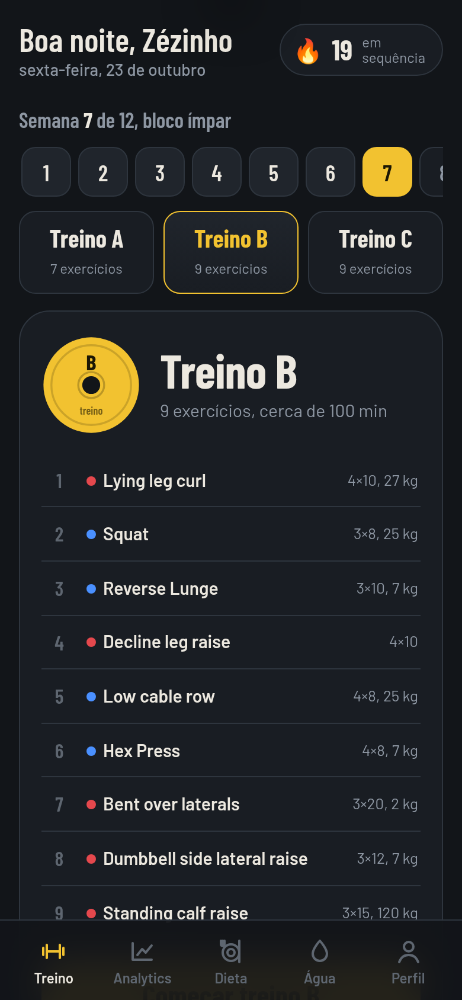
  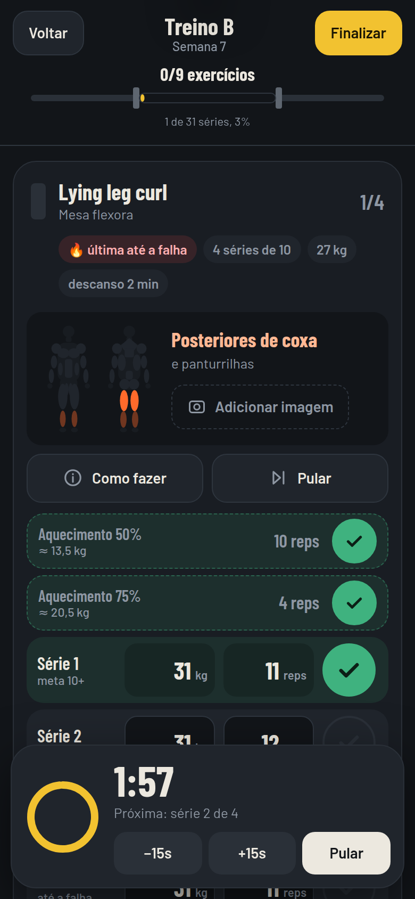
  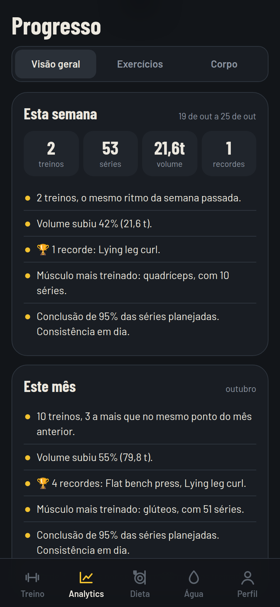
  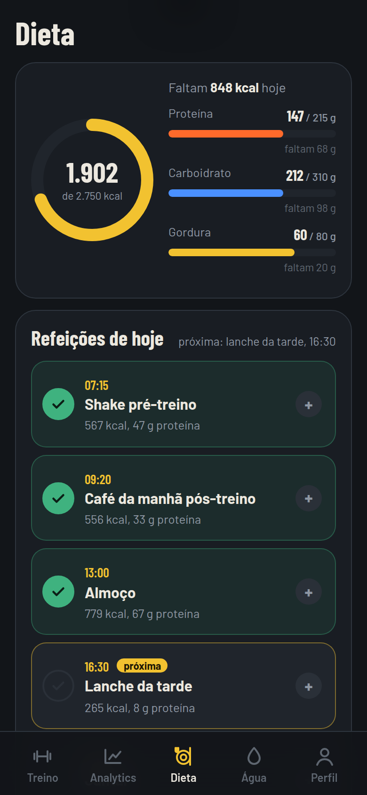
</p>

## Sumário

- [Funcionalidades](#funcionalidades)
- [Como usar](#como-usar)
- [Instalar no Android](#instalar-no-android)
- [Personalizar](#personalizar)
- [Estrutura do projeto](#estrutura-do-projeto)
- [Como os dados são guardados](#como-os-dados-são-guardados)
- [Decisões técnicas](#decisões-técnicas)
- [Limitações conhecidas](#limitações-conhecidas)
- [Licença](#licença)

## Funcionalidades

### Treino

<p>
  
  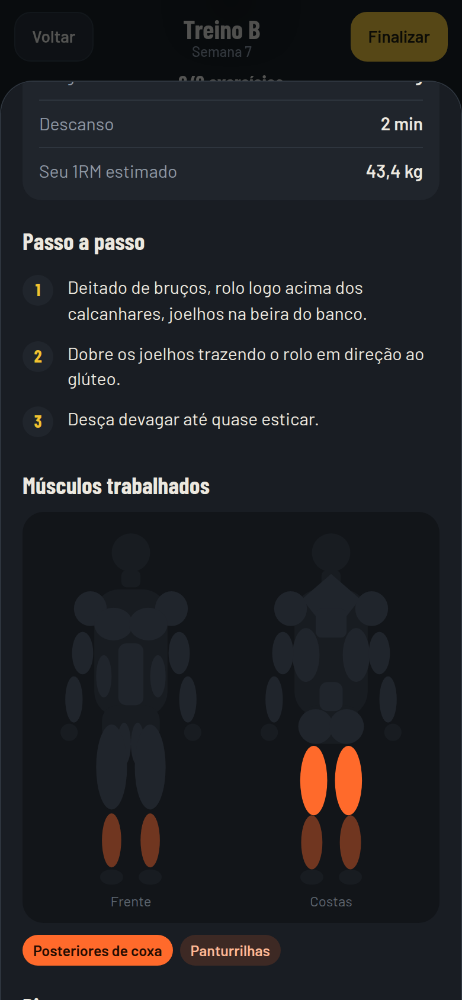
  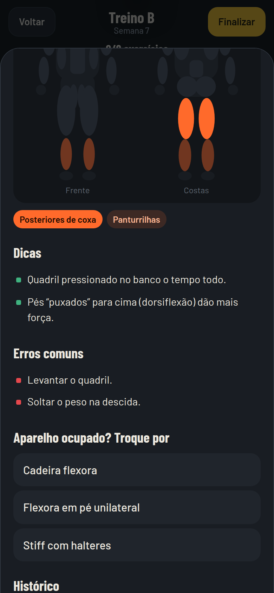
  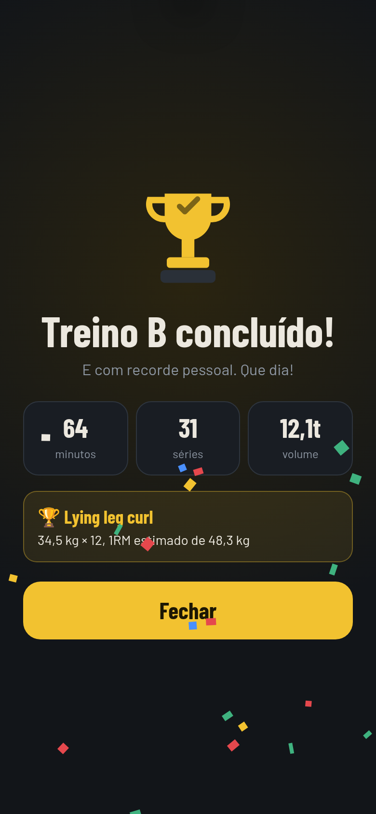
</p>

- Programa de 12 semanas dividido em treinos A, B e C, alternando entre um bloco de semanas ímpares e outro de semanas pares. O app avança sozinho para o próximo treino ao terminar o atual.
- Cada série tem campos grandes de carga e repetições, já preenchidos com o que foi feito da última vez. Um toque no check conclui a série, vibra e inicia o descanso.
- Séries de aquecimento calculadas em percentual da carga de trabalho (50% × 10, 75% × 4 e assim por diante), já convertidas para kg.
- Timer de descanso com o tempo de cada exercício, botões de mais e menos 15 segundos, aviso sonoro e vibração ao terminar. Continua contando certo mesmo com a tela apagada.
- Barra de progresso em forma de barra olímpica: cada exercício concluído coloca uma anilha de cada lado.
- Regras de progressão automáticas: se a série ficar abaixo da meta, a próxima já vem com 10% a menos; se todas as séries passarem da meta em 4 repetições ou mais, o exercício aparece com o aviso para subir a carga no próximo treino.
- Etiquetas de esforço por exercício: parar com 1 ou 2 repetições sobrando, ou levar só a última série até a falha.
- "Como fazer" com passo a passo, mapa muscular de frente e costas (músculos principais e secundários em laranja), dicas, erros comuns, exercícios substitutos para quando o aparelho estiver ocupado e o histórico daquele exercício.
- Opção de pular um exercício com o motivo, que depois aparece nas estatísticas.
- Comemoração ao concluir o treino, com confete, resumo de tempo, séries e volume, recordes pessoais batidos e conquistas desbloqueadas.
- Treino em andamento fica salvo: dá para fechar o app e continuar de onde parou.

### Progresso

<p>
  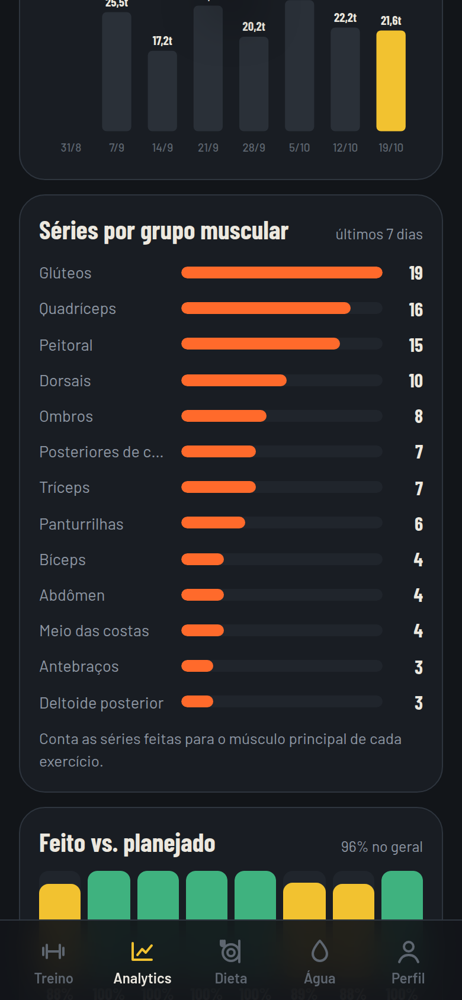
  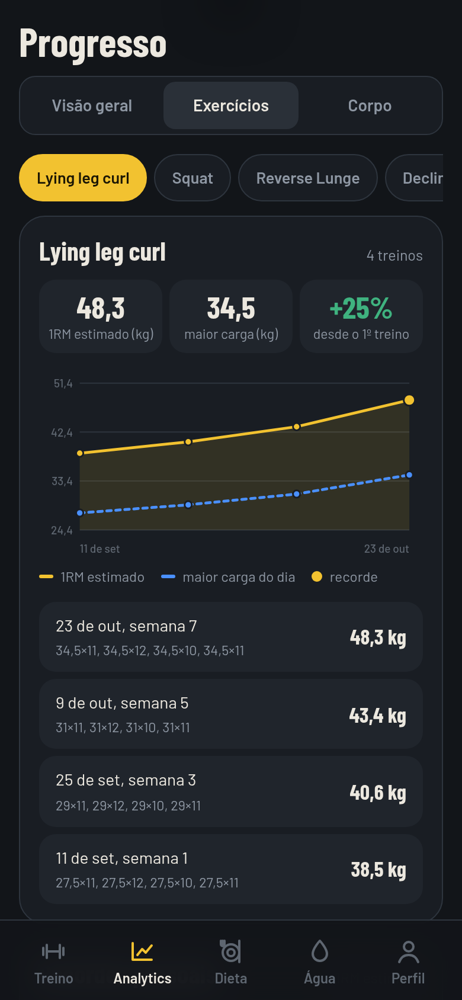
  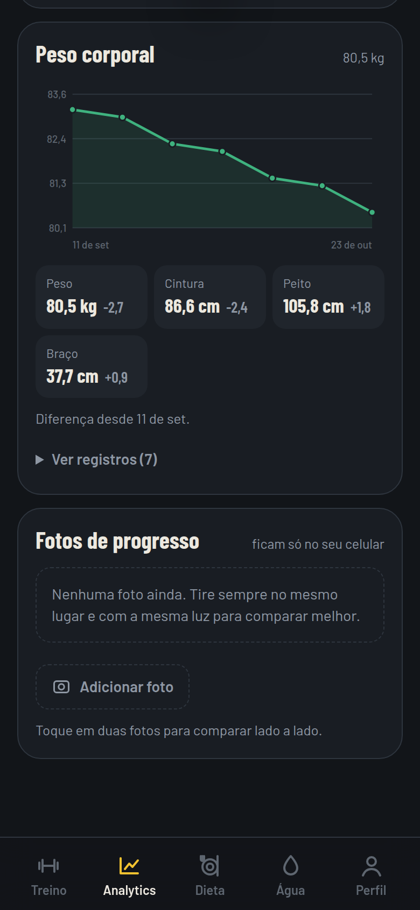
</p>

- Resumo da semana e do mês com insights escritos automaticamente: comparação com o mesmo ponto do período anterior, variação de volume, recordes, músculo mais treinado, grupos sem nenhuma série e motivos de exercícios pulados.
- Calendário de frequência das últimas 18 semanas, com a cor mais forte nos dias com mais séries.
- Volume por semana (séries × repetições × carga) e séries por grupo muscular nos últimos 7 dias.
- Gráfico de feito contra planejado em cada treino.
- Por exercício: evolução do 1RM estimado e da maior carga do dia, ganho percentual desde o primeiro treino e histórico série por série.
- Lista de recordes pessoais de todos os exercícios. O 1RM é estimado pela fórmula de Epley: carga × (1 + repetições ÷ 30).
- Registro de peso, cintura, peito, braço e coxa, com gráfico do peso e diferença desde a primeira medida.
- Fotos de progresso com comparação antes e depois, lado a lado. As fotos ficam só no aparelho.

### Dieta e água

<p>
  
  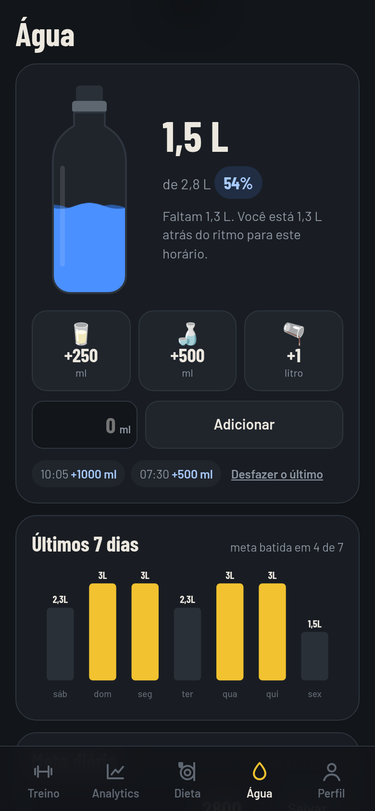
</p>

- Plano alimentar por refeição, com horário, alimentos e macros de cada item.
- Calculadora no topo: marcando o que já comeu, mostra o total de calorias e quanto falta de proteína, carboidrato e gordura até a meta do dia. As marcações recomeçam a cada dia e não viram histórico; a ideia é ajudar, não cobrar.
- A próxima refeição pelo horário fica destacada.
- Edição do plano e das metas direto no app, com opção de voltar ao plano original.
- Água com garrafa que enche com animação, botões rápidos de 250 ml, 500 ml e 1 litro, e campo para outra quantidade.
- Meta de água calculada pelo último peso registrado (35 ml por kg), ou definida à mão.
- Aviso de ritmo: compara o quanto já bebeu com o esperado para o horário, entre 7h e 21h.
- Lembretes configuráveis (a cada 1 h, 1h30 ou 2 h).
- Histórico dos últimos 7 dias.

### Perfil

<p>
  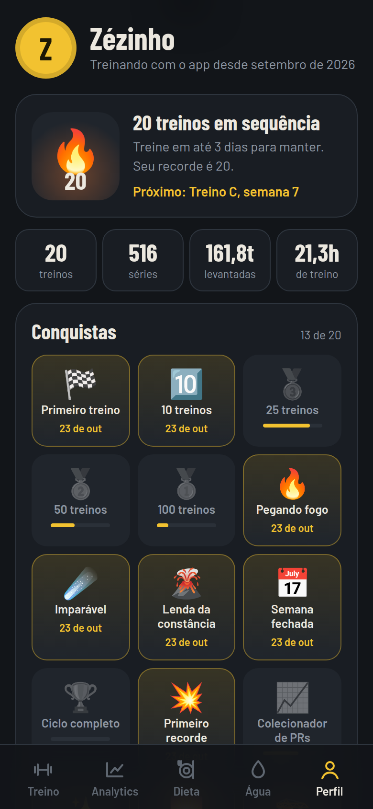
  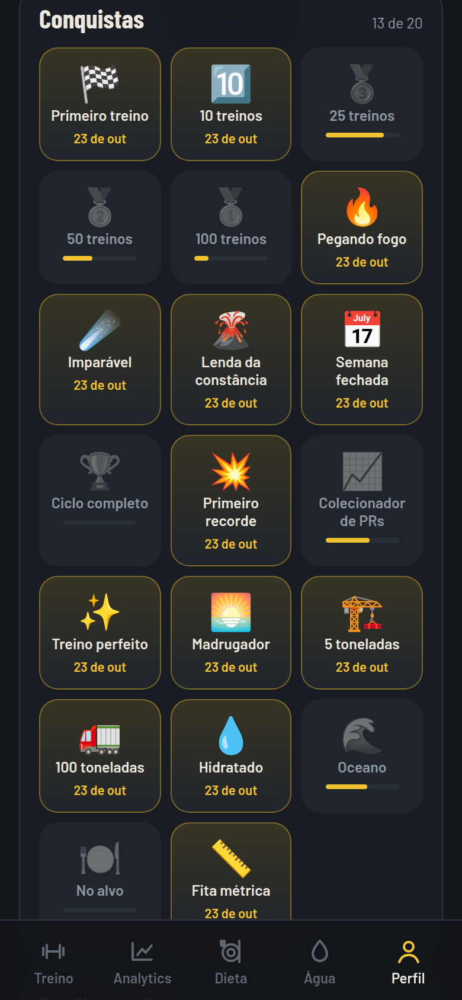
  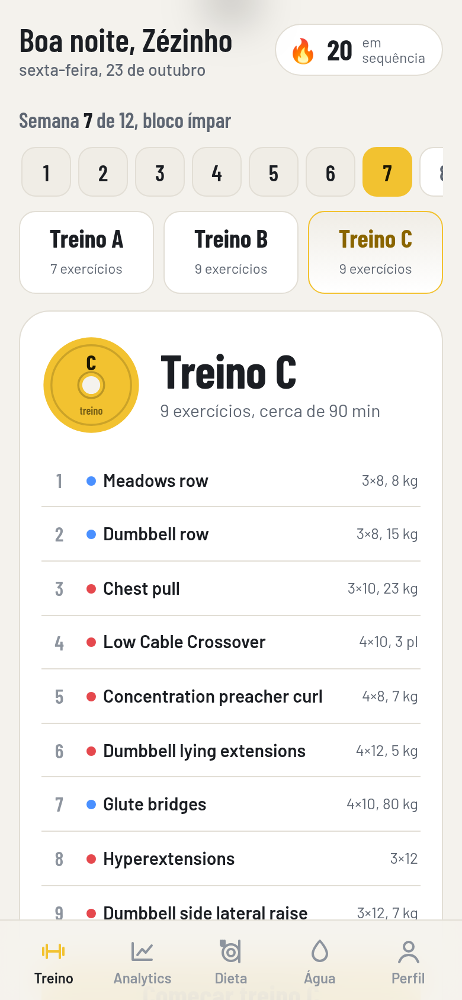
</p>

- Sequência de treinos (com no máximo 2 dias de descanso entre um e outro), recorde de sequência e quantos dias faltam para não perder.
- Totais: treinos, séries, toneladas levantadas e horas de treino.
- 20 conquistas desbloqueáveis, com barra de progresso nas que ainda faltam.
- Tema escuro (padrão) e tema claro. O fundo escuro carrega antes de qualquer outra coisa, então o app não pisca em branco ao abrir.
- Liga e desliga vibração e som.
- Backup: exporta e importa um arquivo JSON com tudo, para trocar de aparelho ou não perder os dados.

## Como usar

### Rodar no computador

Precisa só do Python 3.8 ou mais novo, que já vem instalado no macOS e na maioria das distribuições Linux. No Windows, instale pelo [python.org](https://www.python.org/downloads/).

```bash
git clone https://github.com/fafafers/companion-academia.git
cd companion-academia
python3 build.py
python3 -m http.server 8000 --directory dist
```

Abra `http://localhost:8000` no navegador. Para simular o celular, use o modo de dispositivo das ferramentas de desenvolvedor (F12).

O `build.py` junta o HTML, o CSS e os módulos JavaScript de `src/` em um único `dist/index.html`, copia o conteúdo de `public/` e gera o service worker. Depois de editar qualquer arquivo em `src/`, rode o build de novo.

### Publicar

O resultado é um site estático, então serve em qualquer hospedagem. Três caminhos simples:

**Netlify Drop (o mais rápido).** Rode `python3 build.py --zip`, abra [app.netlify.com/drop](https://app.netlify.com/drop) e arraste o `zezinho-dist.zip`. Crie uma conta gratuita e reivindique o site, senão ele expira. Confira se o acesso ao site está como público. O arquivo `public/_headers` já configura o cache do service worker no Netlify.

**GitHub Pages.** O repositório já tem um workflow em `.github/workflows/pages.yml`. Em *Settings > Pages*, escolha *GitHub Actions* como fonte. A cada push na branch `main`, o site é gerado e publicado em `https://fafafers.github.io/companion-academia/`.

**Outra hospedagem.** Suba o conteúdo da pasta `dist/`. O app precisa de HTTPS para o modo offline funcionar.

## Instalar no Android

### Pela tela inicial

Abra o site no Chrome do celular, toque no menu e escolha *Adicionar à tela inicial* (ou *Instalar app*). Ele abre em tela cheia, com ícone, e funciona offline.

### Como APK

1. Publique o site (veja acima) e copie o endereço.
2. Abra o [PWABuilder](https://www.pwabuilder.com), cole o endereço e toque em **Package For Stores**.
3. Escolha **Android**, deixe a chave de assinatura como **New** e baixe o pacote.
4. Descompacte e abra o arquivo `.apk` no celular. O Android vai pedir para permitir a instalação de apps de fora da loja.
5. Guarde a pasta do pacote em lugar seguro. Ela tem a chave de assinatura, que é necessária para publicar na Play Store ou gerar versões futuras com a mesma identidade. **Nunca suba essa chave para o GitHub**; o `.gitignore` já bloqueia os arquivos mais comuns.

O APK abre o site publicado, então para atualizar o app basta publicar o site de novo. Não é preciso gerar outro APK.

### Remover a barra de endereço do APK

Na primeira instalação, o app costuma mostrar uma barra fina com o endereço do site no topo. Para tirar:

1. Pegue o arquivo `assetlinks.json` que veio no pacote do PWABuilder.
2. Coloque em `public/.well-known/assetlinks.json`.
3. Rode o build e publique de novo.

O arquivo precisa ficar na raiz do domínio (`https://seu-site/.well-known/assetlinks.json`). Por isso, para o APK, o Netlify funciona melhor que o GitHub Pages de projeto, que publica dentro de uma subpasta.

## Personalizar

Tudo que é conteúdo fica em `src/js/data.js`. Depois de editar, rode `python3 build.py`.

### Programa de treino

O programa fica na constante `PROG`, separado em bloco ímpar (`odd`, semanas 1, 3, 5...) e bloco par (`even`, semanas 2, 4, 6...). Cada bloco tem os treinos `A`, `B` e `C`, e cada treino é uma lista de exercícios em ordem:

```js
const PROG = {
  odd: {
    A: [
      { id: 'inclineBench', s: 3, r: 8, kg: 20, u: 'total', rest: 180, t: 'rir', w: [[50, 10], [75, 4]] },
      { id: 'yRaise',       s: 3, r: 10, kg: 7, u: 'cada',  rest: 60,  t: 'fail', w: [[50, 8]] },
      // ...
    ],
    B: [ /* ... */ ],
    C: [ /* ... */ ]
  },
  even: { A: [ /* ... */ ], B: [ /* ... */ ], C: [ /* ... */ ] }
};
```

| Campo | Significado |
| --- | --- |
| `id` | Chave do exercício na biblioteca `EX`. |
| `s` | Número de séries de trabalho. |
| `r` | Repetições mínimas por série (a meta). |
| `kg` | Carga inicial. Depois do primeiro treino, o app usa a carga da última vez. |
| `u` | Unidade da carga: `total` (barra montada), `cada` (cada haltere), `kg`, `placas` (aparelhos com placas numeradas) ou `pc` (peso corporal). |
| `rest` | Descanso em segundos. |
| `t` | Esforço: `rir` (parar com 1 ou 2 repetições sobrando) ou `fail` (última série até a falha). |
| `w` | Aquecimento: lista de `[percentual, repetições]`. Use `[]` para nenhum. |
| `side` | Opcional. `true` para exercícios feitos por perna ou por braço. |
| `rl` | Opcional. `'passos'` quando a meta é em passos (afundo andando). |
| `note` | Opcional. Observação que aparece no card do exercício. |

Para ter um programa sem a alternância de blocos, copie o mesmo conteúdo em `odd` e `even`. O ciclo tem 12 semanas; esse número aparece em `app.js` (seletor de semanas e avanço depois do Treino C).

### Exercícios

A biblioteca `EX` tem 43 exercícios. Cada um tem:

```js
latPulldown: {
  n: 'Lat pulldown',              // nome principal
  pt: 'Puxada alta',              // nome em português (subtítulo)
  p: ['lats'],                    // músculos principais
  s: ['biceps', 'upperback'],     // músculos secundários
  steps: ['...', '...', '...'],   // passo a passo
  tips: ['...'],                  // dicas
  err: ['...'],                   // erros comuns
  subs: ['Barra fixa', '...']     // substitutos
}
```

Os músculos disponíveis estão em `MUSCLES`, no mesmo arquivo, e são os que aparecem no mapa muscular.

### Imagens dos exercícios

O repositório não traz imagens de exercícios: as ilustrações que circulam por aí costumam ter direitos autorais de quem as fez. Sem imagem, o card mostra o mapa muscular com os músculos trabalhados em laranja.

Há dois jeitos de adicionar imagens:

- **No app, para uso próprio.** Em "Como fazer", toque em **Usar minhas fotos** e escolha 1 imagem com as duas posições ou 2 imagens (início e fim). Elas ficam salvas só naquele aparelho.
- **No código, para todo mundo que usar o seu site.** Coloque os arquivos em `public/img/exercicios/` e aponte em `src/js/images.js`:

```js
const BUILTIN = {
  latPulldown: ['img/exercicios/lat-pulldown.webp'],
  squat: ['img/exercicios/squat-inicio.webp', 'img/exercicios/squat-fim.webp']
};
```

A pasta `public/img/exercicios/` está no `.gitignore` para evitar subir imagens de terceiros por engano. Se as imagens forem suas ou tiverem licença livre, apague essas linhas do `.gitignore`.

Para usar imagens no seu próprio site sem publicá-las no repositório, crie `src/js/images.local.js` (também ignorado pelo git). O build inclui esse arquivo logo depois de `images.js`, se ele existir:

```js
Object.assign(BUILTIN, {
  latPulldown: ['img/exercicios/latPulldown.webp']
});
```

### Dieta

O plano fica em `DIET_PLAN` e as metas em `DIET_GOALS`:

```js
const DIET_GOALS = { kcal: 2750, p: 215, c: 310, f: 80 };
const DIET_PLAN = [
  { id: 'm1', time: '07:15', name: 'Shake pré-treino', foods: [
    { n: 'Farelo de aveia', q: '50 g', kcal: 123, p: 8.7, c: 33.1, f: 3.5 },
    // ...
  ] },
  // ...
];
```

Os valores de exemplo foram estimados com a tabela TACO e a base do USDA. Dentro do app, o plano e as metas também podem ser editados em **Editar plano e metas**.

### Água

A meta padrão é 35 ml por kg do último peso registrado, e 2,5 L quando não há peso. Os botões rápidos (`cups`) e a faixa de horário dos lembretes estão na função `defaults()`, em `src/js/app.js`. Ao mudar esses padrões para quem já usa o app, ajuste também a migração em `src/js/init.js`.

### Conquistas

A lista `ACH`, em `src/js/profile.js`, define cada conquista com ícone, título, descrição, meta e uma função que calcula o valor atual:

```js
{ id: 't10', icon: '★', t: '10 treinos', d: 'Conclua 10 treinos', goal: 10, val: () => S.sessions.length }
```

Conquistas novas são verificadas ao terminar um treino, ao registrar água, ao marcar refeições e ao salvar medidas.

### Cores e fontes

As cores são variáveis CSS no começo de `src/styles.css`. As principais:

| Variável | Uso |
| --- | --- |
| `--bg`, `--s1`, `--s2`, `--s3` | Fundo e camadas de superfície |
| `--chalk`, `--muted`, `--dim` | Texto principal e secundários |
| `--y` | Amarelo de destaque (botões, progresso) |
| `--org` | Laranja dos músculos trabalhados |
| `--red`, `--blue`, `--green` | Falha, reps sobrando e concluído |

O tema claro sobrescreve as mesmas variáveis em `:root[data-theme="light"]`, no fim do arquivo. As fontes são Barlow e Barlow Condensed, servidas localmente de `public/fonts/` para funcionar offline.

### Regras de progressão

Estão em `toggleSet()`, em `src/js/app.js`: a redução de 10% quando a série fica abaixo da meta e o aviso de subir carga quando todas as séries passam da meta em 4 repetições.

## Estrutura do projeto

```
companion-academia/
├── build.py                  Gera dist/ (e o zip, com --zip). Só biblioteca padrão do Python.
├── src/
│   ├── index.html            Estrutura da página: abas, telas fixas, timer, folhas
│   ├── styles.css            Todo o visual, incluindo o tema claro
│   └── js/
│       ├── data.js           Programa de treino, biblioteca de exercícios e plano alimentar
│       ├── images.js         Imagens dos exercícios (vazio por padrão)
│       ├── app.js            Estado, tela inicial, treino, timer, recordes e comemoração
│       ├── analytics.js      Aba Progresso: gráficos, insights, medidas e fotos
│       ├── nutrition.js      Abas Dieta e Água, lembretes e resumo da tela inicial
│       ├── profile.js        Aba Perfil: sequência, conquistas, tema e backup
│       └── init.js           Inicialização e ajustes de versões anteriores
├── public/
│   ├── manifest.webmanifest  Nome, cores e ícones do app instalado
│   ├── sw.template.js        Modelo do service worker (o build preenche versão e arquivos)
│   ├── _headers              Cabeçalhos de cache para o Netlify
│   ├── icons/                Ícones do app (comuns e maskable)
│   ├── fonts/                Barlow e Barlow Condensed (licença OFL)
│   ├── img/exercicios/       Imagens próprias de exercícios (fora do git por padrão)
│   └── screenshots/          Capturas usadas pelo manifesto na tela de instalação
├── docs/screenshots/         Capturas deste README
└── .github/workflows/        Publicação automática no GitHub Pages
```

O JavaScript é dividido em arquivos por aba, mas roda como um único script. A ordem de junção está em `JS_FILES`, no `build.py`, e importa: `data.js` vem primeiro e `init.js` por último.

## Como os dados são guardados

Nada sai do aparelho. Não há servidor, conta nem coleta de dados.

| Onde | O quê |
| --- | --- |
| `localStorage`, chave `zezinho.v1` | Treinos, treino em andamento, medidas, plano e metas da dieta, água, conquistas e preferências |
| IndexedDB `zezinho-fotos`, store `img` | Fotos de exercícios adicionadas pelo usuário |
| IndexedDB `zezinho-fotos`, store `prog` | Fotos de progresso |

O app pede armazenamento persistente ao navegador para reduzir o risco de os dados serem apagados quando o celular está sem espaço. Mesmo assim, limpar os dados do navegador apaga tudo, por isso existe o backup em **Perfil**.

O backup é um JSON com este formato:

```json
{
  "app": "zezinho",
  "v": 1,
  "at": "2026-10-23T21:40:00.000Z",
  "state": { "sessions": [], "body": [], "diet": {}, "water": {}, "ach": {}, "profile": {} }
}
```

As fotos não entram no backup, para manter o arquivo pequeno.

## Decisões técnicas

- **Sem framework e sem dependências.** Tudo é HTML, CSS e JavaScript puros. O build é um script Python de cerca de 70 linhas que só junta arquivos. Qualquer pessoa consegue abrir, entender e alterar sem instalar nada.
- **Um arquivo só.** O resultado é um `index.html` de uns 180 KB com tudo dentro, o que simplifica a hospedagem e o cache offline.
- **Gráficos em SVG feitos à mão.** Linhas, barras, anéis e o calendário de frequência são gerados por funções pequenas em `analytics.js`, sem biblioteca de gráficos.
- **Offline primeiro.** O service worker responde do cache na hora e busca a versão nova em segundo plano. Cada build gera uma versão nova do cache, então o app instalado se atualiza sozinho.
- **Timer baseado em horário, não em contagem.** O descanso guarda o horário de término, então continua certo mesmo que o navegador pause o app em segundo plano.
- **Pensado para a academia.** Botões e campos grandes, ações principais na metade de baixo da tela, vibração ao concluir séries e textos curtos.

## Limitações conhecidas

- **Lembretes de água com o app fechado.** Notificações agendadas precisariam de um servidor de push. Os lembretes funcionam com o app aberto ou recém-minimizado; com ele totalmente fechado, o Android pode não entregar.
- **Dados por aparelho.** Não há sincronização entre celular e computador. Use o backup para levar os dados de um para o outro.
- **Estimativas.** O 1RM é uma estimativa pela fórmula de Epley e os macros do plano de exemplo são aproximados. Nenhum dos dois substitui a orientação de um profissional de educação física ou nutrição.
- **Ciclo fixo de 12 semanas.** Mudar a duração exige editar `app.js`, como descrito em [Programa de treino](#programa-de-treino).

## Licença

Código sob a licença MIT; veja [LICENSE](LICENSE). As fontes Barlow e Barlow Condensed são do [Barlow Project](https://github.com/jpt/barlow) e seguem a SIL Open Font License 1.1, incluída em `public/fonts/OFL.txt`.
